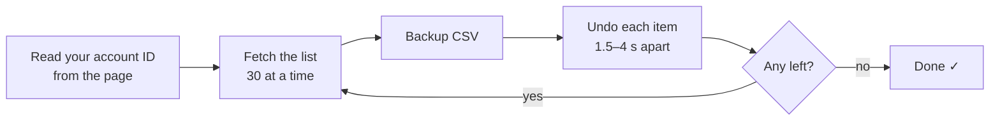

<picture>
  <source media="(prefers-color-scheme: dark)" srcset="assets/banner-dark.svg">
  
</picture>

<p align="center">
  <a href="#quick-start"><b>Quick start</b></a> ·
  <a href="#what-it-cleans"><b>What it cleans</b></a> ·
  <a href="#how-it-works"><b>How it works</b></a> ·
  <a href="#faq"><b>FAQ</b></a>
</p>

<p align="center">
  
  
  
</p>

<br>

TikTok makes you undo reposts, likes, favorites and follows one tap at a time. With thousands of them, that's days of tapping.
**TikTok Cleanup** does it for you: paste one script into your browser, pick what to clear, and leave it running.

<p align="center">
  
</p>

## Quick start

1. **Log in** at [tiktok.com](https://www.tiktok.com) on a computer.
2. **Open the console**
   - Chrome / Edge / Brave — <kbd>⌘</kbd> <kbd>⌥</kbd> <kbd>J</kbd> (Windows: <kbd>Ctrl</kbd> <kbd>Shift</kbd> <kbd>J</kbd>)
   - Safari — <kbd>⌘</kbd> <kbd>⌥</kbd> <kbd>C</kbd> (first enable *Settings → Advanced → Show features for web developers*)
3. **Paste** the contents of [`tiktok-cleanup.js`](tiktok-cleanup.js) and press <kbd>Enter</kbd>.
   Tip: on the file page, use GitHub's *Copy raw file* button.
4. **Pick a tab** — Reposts, Likes, Favorites or Following.
5. **Press `Test`**, then check that tab on your profile to confirm a few are gone.
6. **Press `Remove all`**, confirm, and go to sleep. A backup CSV downloads first.

> [!TIP]
> Leaving it overnight? Keep the TikTok tab in front, plug in your charger, and stop your Mac from sleeping with `caffeinate -d` in Terminal.

## What it cleans

| Tab | What it does | Test size |
|---|---|---|
| **Reposts** | Un-reposts every video you've reposted | 5 |
| **Likes** | Unlikes every video you've liked | 5 |
| **Favorites** | Removes every video from your Favorites | 5 |
| **Following** | Unfollows everyone — except the accounts you list to keep | 3 |

## Features

| Feature | What it does |
|---|---|
| **Backup first** | Before *Remove all*, downloads a CSV of everything it's about to remove — links, usernames and captions. |
| **Keep list** | On *Following*, type `@bestie, @mom` and those accounts are never unfollowed. |
| **Test before you commit** | *Test* clears just a few so you can verify. *Remove all* asks you to confirm with the exact count. |
| **No scrolling, no lag** | Reads your lists straight from TikTok — thousands of items, one run. |
| **Live progress** | Count, progress bar, speed and time remaining. Pause, resume or stop anytime. |
| **Polite by default** | Random 1.5–4 s pause between actions (a bit slower for unfollows). Backs off automatically, 1 → 30 min, if TikTok rate-limits. |
| **Safety checks** | Verifies TikTok actually applied each unlike and unfollow — stops instead of guessing if it didn't. |
| **Finishes the job** | After each pass, re-checks the list and sweeps up anything missed. |
| **Private** | Runs entirely in your own logged-in tab. No password, no server, no tracking. |

## How it works

TikTok's website loads each of these lists from an internal endpoint, and undoes each item with a single request when you tap a button. The script makes those same requests directly from your logged-in tab — no clicking, no opening videos.



| Items | Approx. time |
|---:|---|
| 100 | ~5 min |
| 500 | ~25 min |
| 2,000 | ~1.5–2.5 h |

Unfollowing runs about 1.6× slower, since TikTok is stricter about follow changes.

## FAQ

<details>
<summary><b>Is my account safe?</b></summary>
<br>
The script uses your existing session in your own browser — the same requests TikTok's website sends when you tap the buttons. Your password never leaves the page. That said, this is an unofficial tool that automates actions on your account; the conservative default speed is there to keep things looking like normal use.
</details>

<details>
<summary><b>Can I undo it?</b></summary>
<br>
Not in bulk. That's what the backup CSV is for: it lists every video and account that was removed, with links, so you can find anything again. Always run <code>Test</code> first.
</details>

<details>
<summary><b>I see a red <code>worker-src</code> / <code>blob:</code> message in the console.</b></summary>
<br>
Harmless. TikTok blocks background timers; the script detects that and falls back to normal timers. Just keep the tab in front.
</details>

<details>
<summary><b>It says "TikTok is slowing us down".</b></summary>
<br>
That's the rate-limit backoff working. It waits and continues on its own.
</details>

<details>
<summary><b>It says "Stopped for safety".</b></summary>
<br>
TikTok accepted the request but didn't actually apply it, so the script stopped rather than keep going. TikTok probably changed something — please <a href="../../issues">open an issue</a> with the red console messages.
</details>

<details>
<summary><b>It stopped, or some items are still there.</b></summary>
<br>
Refresh tiktok.com, paste the script again and press <code>Remove all</code> — it picks up whatever is left.
</details>

<details>
<summary><b>Does it work on my phone?</b></summary>
<br>
No — it needs a desktop browser with a developer console.
</details>

## Development

```bash
npm install
npm test   # runs every tab against a simulated TikTok backend
```

## Credits

The list and undo requests build on research by [gabireze](https://github.com/gabireze) — see their MIT-licensed [repost](https://github.com/gabireze/tiktok-all-reposted-videos-remover), [likes](https://github.com/gabireze/tiktok-all-liked-videos-remover) and [favorites](https://github.com/gabireze/tiktok-all-favorite-videos-remover) removers if you'd prefer a Chrome extension. Endpoint details were cross-checked against [gallery-dl](https://github.com/mikf/gallery-dl) and [cv-cat/TiktokApis](https://github.com/cv-cat/TiktokApis).

## License

[MIT](LICENSE). Not affiliated with, endorsed by, or sponsored by TikTok or ByteDance. Use at your own risk.
