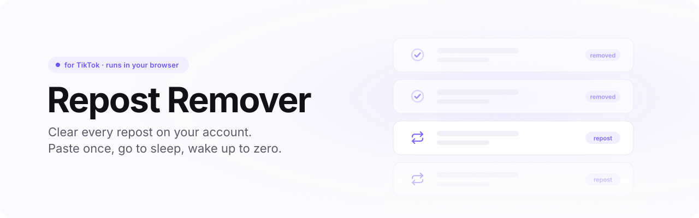
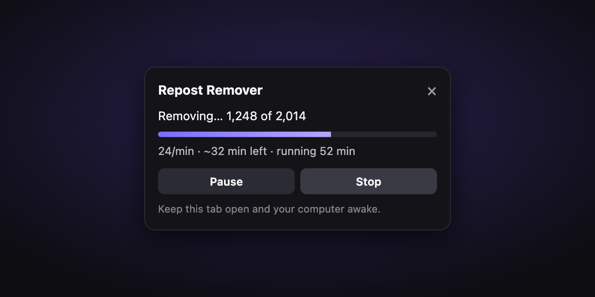
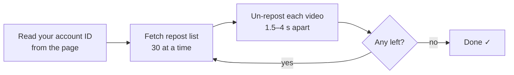

<picture>
  <source media="(prefers-color-scheme: dark)" srcset="assets/banner-dark.svg">
  
</picture>

<p align="center">
  <a href="#quick-start"><b>Quick start</b></a> ·
  <a href="#how-it-works"><b>How it works</b></a> ·
  <a href="#faq"><b>FAQ</b></a>
</p>

<p align="center">
  
  
  
</p>

<br>

TikTok only lets you un-repost videos one at a time. With a few thousand reposts that's an evening of tapping.
**Repost Remover** does it for you: paste one script into your browser, press a button, and leave it running.

<p align="center">
  
</p>

## Quick start

1. **Log in** at [tiktok.com](https://www.tiktok.com) on a computer.
2. **Open the console**
   - Chrome / Edge / Brave — <kbd>⌘</kbd> <kbd>⌥</kbd> <kbd>J</kbd> (Windows: <kbd>Ctrl</kbd> <kbd>Shift</kbd> <kbd>J</kbd>)
   - Safari — <kbd>⌘</kbd> <kbd>⌥</kbd> <kbd>C</kbd> (first enable *Settings → Advanced → Show features for web developers*)
3. **Paste** the contents of [`tiktok-repost-remover.js`](tiktok-repost-remover.js) and press <kbd>Enter</kbd>.
   Tip: on the file page, use GitHub's *Copy raw file* button.
4. **Press `Test 5`**, refresh your Reposts tab in another tab, and check five are gone.
5. **Press `Remove all`** — and go to sleep.

> [!TIP]
> Leaving it overnight? Keep the TikTok tab in front, plug in your charger, and stop your Mac from sleeping with `caffeinate -d` in Terminal.

## Features

|  |  |
|---|---|
| **No scrolling, no lag** | Reads your repost list straight from TikTok — thousands of reposts, one run. |
| **Test before you commit** | `Test 5` removes five so you can verify before running everything. |
| **Live progress** | Count, progress bar, speed and time remaining. Pause, resume or stop anytime. |
| **Polite by default** | Random 1.5–4 s pause between removals. Backs off automatically (1 → 30 min) if TikTok rate-limits. |
| **Finishes the job** | After the pass, it re-checks your list and sweeps up anything missed. |
| **Private** | Runs entirely in your own logged-in tab. No password, no server, no tracking. |
| **Scoped** | Touches reposts only — never your videos, likes or favorites. |

## How it works

TikTok's own website loads your reposts from a list endpoint and un-reposts through a single request when you tap the button. The script makes those same requests directly — no clicking, no opening videos.



| Reposts | Approx. time |
|---:|---|
| 100 | ~5 min |
| 500 | ~25 min |
| 2,000 | ~1.5–2.5 h |

Want a count first? Paste [`count-reposts.js`](count-reposts.js) — it's read-only and just prints how many reposts you have.

## FAQ

<details>
<summary><b>Is my account safe?</b></summary>
<br>
The script uses your existing session in your own browser — the same requests TikTok's website sends when you tap the button. Your password never leaves the page. That said, this is an unofficial tool that automates actions on your account; the conservative default speed is there to keep things looking like normal use.
</details>

<details>
<summary><b>Can I undo it?</b></summary>
<br>
No. Removed reposts can't be restored in bulk — you'd have to repost them again by hand. Use <code>Test 5</code> first.
</details>

<details>
<summary><b>I see a red <code>worker-src</code> / <code>blob:</code> message in the console.</b></summary>
<br>
Harmless. TikTok blocks background timers; the script detects that and falls back to normal timers. Just keep the tab in front.
</details>

<details>
<summary><b>It says "TikTok is slowing us down".</b></summary>
<br>
That's the rate-limit backoff working. It waits and continues on its own.
</details>

<details>
<summary><b>It stopped, or my reposts are still there.</b></summary>
<br>
Refresh tiktok.com, paste the script again and press <code>Remove all</code> — it picks up whatever is left. If it keeps failing, TikTok may have changed something: <a href="../../issues">open an issue</a> with the red console messages.
</details>

<details>
<summary><b>Does it work on my phone?</b></summary>
<br>
No — it needs a desktop browser with a developer console.
</details>

## Development

```bash
npm install
npm test   # runs the script against a simulated TikTok backend
```

## Credits

The list and un-repost requests were figured out by [gabireze/tiktok-all-reposted-videos-remover](https://github.com/gabireze/tiktok-all-reposted-videos-remover) (MIT) — check it out if you'd prefer a Chrome extension.

## License

[MIT](LICENSE). Not affiliated with, endorsed by, or sponsored by TikTok or ByteDance. Use at your own risk.
